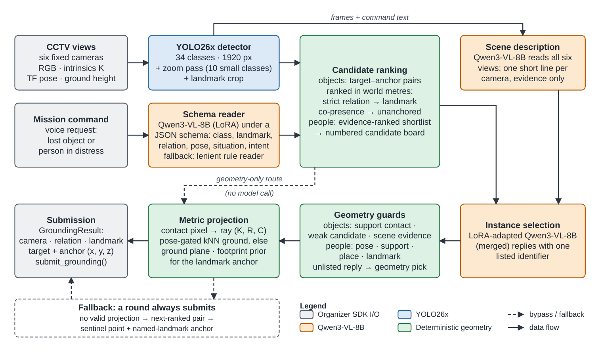
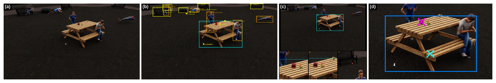

<div align="center">

<h1>Grounding Vision–Language Models for Target Localization<br><sub>IEEE MetaCom 2026 · MARC Challenge</sub></h1>

<hr>

<p>
  <strong>Muhammad Ahmad Nadeem</strong><sup>*</sup> &nbsp;·&nbsp;
  <strong>Luka Turmanidze</strong><sup>*</sup> &nbsp;·&nbsp;
  <strong>Bhawish Kumar</strong><sup>*</sup> &nbsp;·&nbsp;
  <strong>Habibul Bashar</strong><sup>*</sup> &nbsp;·&nbsp;
  <strong>Martin M. T. Choy</strong> &nbsp;·&nbsp;
  <strong>Kam Kong Cheng</strong>
</p>
<p>
  Department of Computer Science, Hong Kong Baptist University &nbsp;|&nbsp; <sup>*</sup>Equal contribution
</p>

<p>
  Official implementation of <strong>Team roBUst</strong>'s offline embodied perception system for the
  <strong>Meta-Sejong AI Robotics Challenge (MARC) 2026</strong>, awarded the
  <strong>Excellence Award (2nd Prize)</strong> with the <strong>highest Stage 1 score</strong> of the competition.
  We decompose language-conditioned object and search-and-rescue localization across six fixed campus CCTV views into
  <strong>all-camera YOLO26x detection</strong>, <strong>finite-identifier LoRA Qwen3-VL-8B selection with deterministic geometric guards</strong>,
  and <strong>pose-gated calibrated ground projection</strong>.
</p>

<p>
  <a href="paper/MARC2026_Grounding_VLMs.pdf"></a>
  <a href="#results"></a>
  <a href="#results"></a>
  <a href="https://huggingface.co/roBUst-marc-2026"></a>
  <a href="#demo-videos"></a>
</p>

</div>

- **Paper:** *Grounding Vision–Language Models for Target Localization* ([Read PDF](paper/MARC2026_Grounding_VLMs.pdf) · IEEE MetaCom 2026, in press)
- **Models:** [Stage 1 YOLO26x (34-class)](https://huggingface.co/roBUst-marc-2026/stage1-cctv-detector) · [LoRA Qwen3-VL-8B Selector](https://huggingface.co/roBUst-marc-2026/qwen3-vl-8b-stage1-finetuned)
- **Videos:** [System Showcase (2:49)](#system-showcase-249) · [Single-Round Walkthrough `hf03` (2:43)](#single-round-walkthrough-hf03-243)
- **Code Freeze:** Tag [`final-system-v1`](https://github.com/hkbu-robust/marc-2026/tree/final-system-v1) matches the cleaned system evaluated in the paper and final competition submission.

<p align="center">
  
  <br>
  <em><strong>Figure 1.</strong> Stage 1 runtime path. YOLO26x proposes 34-class instances across all six CCTV views; LoRA-adapted Qwen3-VL-8B parses the command under a JSON schema and selects one listed identifier from a geometry-ranked candidate board; deterministic guards verify or override the pick before metric ray projection onto a pose-gated calibrated ground surface.</em>
</p>

https://github.com/user-attachments/assets/3ad78b6e-e77d-4df2-b94e-8dde11efc0d4

<p align="center">
  <em><strong>3D Localization Preview (18 s, 720p):</strong> Calibrated camera rays from six fixed CCTV rigs intersecting the learned ground surface and landmark support plane on round <code>hf03</code> (logged <code>final-system-v1</code> run).</em>
</p>

---

## Overview

MARC 2026 Stage 1 tasks a strictly offline agent with interpreting a natural-language request (e.g., *"the tumbler near the fire hydrant"* or a search-and-rescue distress description), identifying the correct instance across six fixed campus CCTV views in an NVIDIA Isaac Sim digital twin, and returning metric 3D world coordinates for both the target and its landmark anchor.

Our pipeline cleanly separates visual proposal, symbolic reasoning, and metric projection:

1. **All-Camera Detection (`marc_agent/perception/cctv_yolo.py`):** A fine-tuned 34-class **YOLO26x** detector runs at `1920 px` across all six CCTV views, augmented by a **2× zoomed pass** for 10 data-derived small-object classes (`< 5×10⁻⁴` frame area) and a `960 px` landmark crop pass.
2. **Schema-Constrained Command Parsing (`marc_agent/command_llm.py`):** Local **Qwen3-VL-8B** parses each request under a strict JSON schema (`temp = 0`, `seed = 0`) with a lenient deterministic rule fallback so every round produces a valid structured query.
3. **Finite-Identifier Selection + Deterministic Guards (`marc_agent/perception/`):** Geometry ranks target–anchor pairs in world metres and renders a numbered visual candidate board. The LoRA-adapted **Qwen3-VL-8B** returns a single listed identifier; deterministic pose, support-contact, scene-evidence, and weak-candidate guards verify or override the pick, while geometry acts as both base answer and safety net ([ADR 0001](docs/adr/0001-stage1-vlm-selector-and-geometry-guards.md)).
4. **Calibrated Metric Projection (`marc_agent/perception/ground_model.py`):** The selected contact pixel is cast along camera ray `(K, R, C)` onto a pose-gated `k`-NN calibrated ground surface (`k = 12`) when matching the calibrated site (falling back to the flat ground plane on unseen poses), paired with a class landmark footprint prior fitted on held-out scenes.

<p align="center">
  
  <br>
  <em><strong>Figure 2.</strong> Round <code>hf03</code> (<code>rig_1_a</code>): “I was reading with a coffee at an outdoor table and left my mug there.” (a) Raw CCTV view, (b) YOLO26x detections with picnic-table landmark in cyan, (c) numbered candidate board sent to Qwen3-VL-8B, and (d) submitted target (magenta) and anchor (cyan) coordinates projected onto the table plane.</em>
</p>

> **Generalization & evaluation integrity:** Before final submission and publication, we audited our pipeline for any heuristics fitted to the 33 public practice rounds and deleted them permanently. Both the paper results below and our competition Stage 1 award come strictly from the cleaned `final-system-v1` system ([ADR 0002](docs/adr/0002-final-stage1-system-cleanup.md)).

---

## Results

Across **10 cold starts** of the 33 public practice rounds (`marc2026_chungmu`), the deployed Stage 1 system achieves **`87.25 ± 0.71`** (median **`87.54`**, 8/10 runs within `0.01`; simulation-time p95 **`4.00 s`** against a `30 s` limit). The deployed 34-class YOLO26x detector reaches **`0.967 mAP@50`** / **`0.883 mAP@50:95`** (`262`-image validation split; `51.23 ms` median per frame on an RTX PRO 6000 Blackwell Max-Q).

### End-to-End Selector Comparison (Paper Table III, 3 Public Runs)

| Configuration | Stage 1 Score | Camera | Type | Landmark | Relation | Anchor | Target |
| :--- | :---: | :---: | :---: | :---: | :---: | :---: | :---: |
| Geometry + Rule Reader | `66.36 ± 3.97` | 0.667 | 0.869 | 0.895 | 0.842 | 0.560 | 0.590 |
| Base `Qwen3-VL-8B` | `85.29 ± 1.27` | 0.869 | 1.000 | 0.877 | 0.842 | 0.737 | 0.808 |
| **Fine-tuned `Qwen3-VL-8B` (Deployed)** | **`87.54 ± 0.00`** | **0.879** | **1.000** | **0.895** | **0.895** | **0.746** | **0.848** |

### Ground Surface & Footprint Prior Ablation (Paper Table VI)

*Public column: 10 replayed practice runs; Held-out column: unseen odd scenes (`n = 250` anchor, `n = 167` target).*

| Projection Configuration | Public Score | Public Anchor | Held-out Anchor | Held-out Target Median Err. |
| :--- | :---: | :---: | :---: | :---: |
| Flat Ground Plane | 84.90 | 0.671 | 0.793 | 0.45 m |
| Footprint Prior Only | 85.20 | 0.690 | 0.803 | 0.45 m |
| Calibrated Ground Only | 86.67 | 0.707 | 0.845 | **0.07 m** |
| **Calibrated Ground + Footprint (Deployed)** | **87.25** | **0.740** | **0.862** | **0.07 m** |

### Key Ablation & Error Ledger Highlights

- **Small-object zoom pass (Table II):** Lifts held-out `< 8 px` object recall from **`70% → 80%`** (`147/210 → 169/210`) and overall small-class recall from **`85% → 90%`** (`366/433 → 388/433`).
- **Held-out generalization (Table V, 530 cases) & blind paraphrases (60 cases):** On identical candidates, the LoRA-adapted selector outperforms base `Qwen3-VL-8B` by **`+8.8 pts`** on object pair exact match (**`67.8%`** vs. `59.0%`, 95% CI `[3.9, 13.6]`). On 60 blind paraphrases, the schema-constrained reader recovers target / landmark / relation in **`55/56`**, **`54/56`**, and **`50/55`** cases (vs. `48/56`, `44/56`, `41/55` for the rule fallback).
- **Transparent error ledger (Table IV, `12.75` pts lost/round):** `9.09` pts from targets completely occluded beneath a person in all views, `2.06` pts from underdetermined command phrasing, `1.30` pts from anchor projection without depth, and `0.30` pts from two single-run misses.

---

## Demo Videos

Both films are rendered directly from the real run logs, calibrated cameras, and ground model of the frozen `final-system-v1` submission (`87.54` run).

### System Showcase (2:49)

Full pipeline overview, 3D calibrated six-camera ray projection, SAR rounds, and quantitative results.

https://github.com/user-attachments/assets/8c56338c-5093-463e-9761-91163366ed36

### Single-Round Walkthrough `hf03` (2:43)

Step-by-step trace of round `hf03` (*"left my mug there"*) from raw frames and YOLO boxes to Qwen3-VL candidate board selection and 3D submission.

https://github.com/user-attachments/assets/563d18ea-0039-424c-9abc-14f48b4028f4

---

## Quick Start

### Containerized Offline Runtime (Ubuntu 22.04 + NVIDIA Docker)

```bash
git clone https://github.com/hkbu-robust/marc-2026.git
cd marc-2026
export MARC_TOKEN=<your-session-token>   # or copy demo/.env.example -> .env
docker compose up
```

| Service | Purpose |
|---|---|
| `qwen` | Baked `vllm/vllm-openai:v0.22.0` server serving the fine-tuned `Qwen3-VL-8B` weights on participant loopback (`127.0.0.1:8004`) |
| `agent` | ROS 2 Humble participant running `demo/participant_app.py` with baked YOLO26x checkpoints; starts once `qwen` passes its health check |

### CPU Unit & Replay Tests (No GPU / No ROS 2)

```bash
pip install -e ".[test]"
pytest
```

For local Isaac Sim practice setup, remote vLLM overrides, environment variables, and paper table reproduction commands, see **[docs/reproduce.md](docs/reproduce.md)**.

---

## Repository Structure

```text
marc-2026/
├── marc_agent/            # Core ROS-free Stage 1 perception, schema parser, projection & guards (+ Stage 2 runtime*)
├── demo/                  # ROS 2 participant entry point, Dockerfiles, vLLM entrypoint & dataset converters
├── scripts/               # Stage 1 repeated runs, CPU projection replay, held-out selector arms & paper numbers
├── training/              # YOLO26x detector and Qwen3-VL-8B LoRA fine-tuning & evaluation pipelines
├── models/runtime/        # Offline weight fetcher, pinned HF revisions, checksums & runtime contracts
├── simulation-platform/   # Organizer Isaac Sim Dockerfile kit + team dataset-generation patches
├── marc_sdk/              # Organizer ROS 2 protocol client (MIT)
├── tests/                 # CPU unit & replay test suite (pytest)
├── docs/                  # Architecture decision records (ADRs), reproduction guide & paper figures
└── paper/                 # Author-accepted camera-ready manuscript PDF
```

*\*Note: Mobile navigation, near-field RGB-D perception, and GraspGen-X manipulation modules under `marc_agent/` and `demo/` are retained as part of the full competition Docker submission and are outside the scope of the Stage 1 IEEE MetaCom 2026 paper.*

---

## Citation

If you find this code, evaluation harness, or paper useful, please cite:

```bibtex
@inproceedings{nadeem2026grounding,
  title     = {Grounding Vision--Language Models for Target Localization},
  author    = {Nadeem, Muhammad Ahmad and Turmanidze, Luka and Kumar, Bhawish and Bashar, Habibul and Choy, Martin M. T. and Cheng, Kam Kong},
  booktitle = {Proceedings of the IEEE International Conference on Metaverse Computing, Networking and Applications (MetaCom)},
  year      = {2026}
}
```

---

## License & Acknowledgements
- **Code license:** Original Team roBUst source code is licensed under the **[MIT License](LICENSE)**. Running the combined system with Ultralytics and the fine-tuned YOLO26x weights (`models/runtime/stage1-cctv-detector/LICENSE`) forms a combined work subject to **GNU AGPL-3.0**. Third-party licenses, organizer starter-kit attributions, and 3D asset credits are detailed in **[NOTICES.md](NOTICES.md)**.
- **IEEE manuscript notice:** *© 2026 IEEE. Personal use of this material is permitted. Permission from IEEE must be obtained for all other uses, in any current or future media, including reprinting/republishing this material for advertising or promotional purposes, creating new collective works, for resale or redistribution to servers or lists, or reuse of any copyrighted component of this work in other works.*
- **Acknowledgements:** We thank the **Meta-Sejong AI Robotics Challenge (MARC) 2026** organizers (Sejong University / IoTCOSS) for the Isaac Sim digital twin, ROS 2 SDK, and evaluation benchmark, and the **Department of Computer Science, Hong Kong Baptist University** for compute support. Built on `Ultralytics YOLO26`, `Qwen3-VL`, `vLLM`, and `ROS 2 Humble`.
