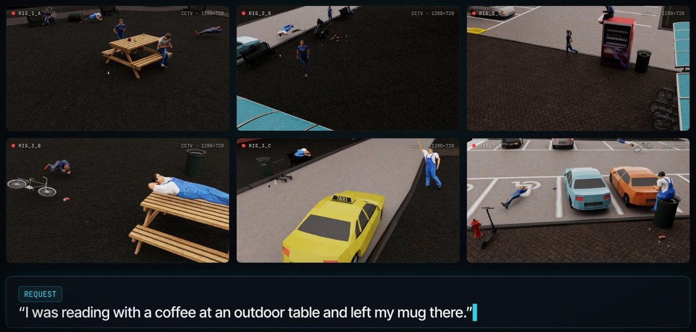
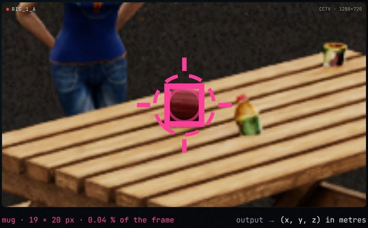
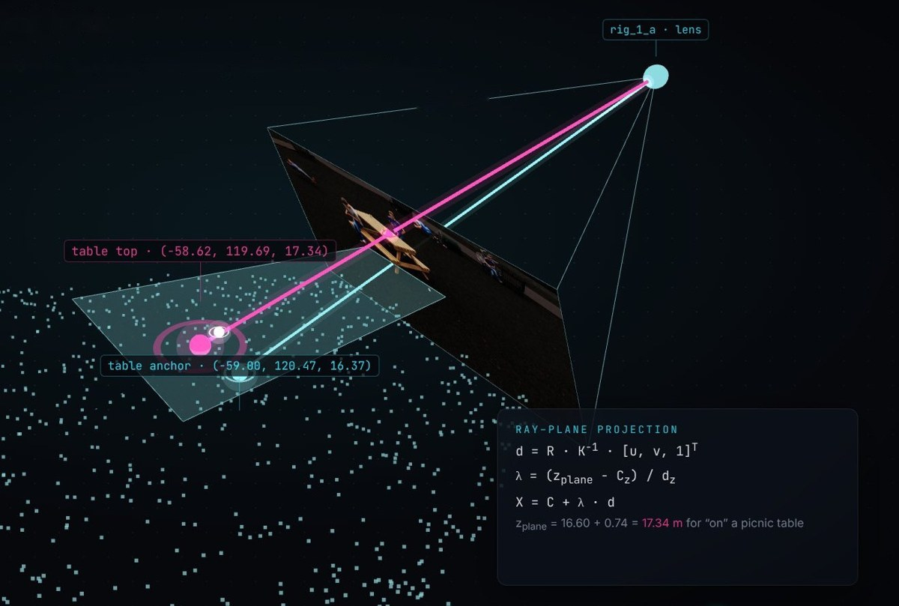
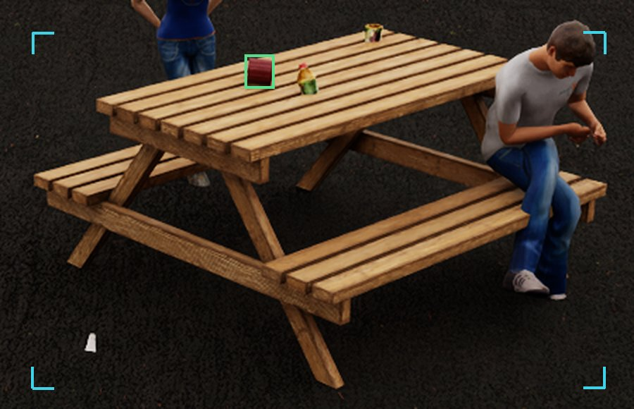
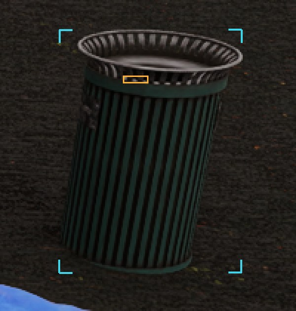
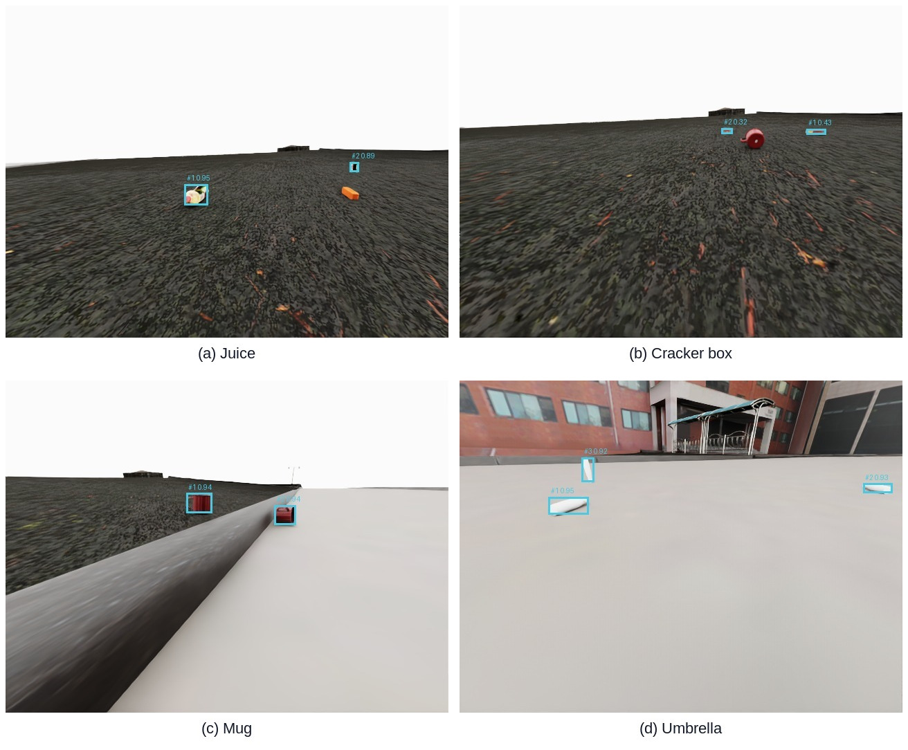

# Meta Sejong AI Robotics Challenge - roBUst Team 

## Challenge Introduction
MARC 2026 is an AI robotics competition held in a digital replica of Sejong University’s campus. Teams build a single AI agent that interprets everyday requests, such as finding an umbrella beside a bench. In the required first stage, the agent uses fixed CCTV feeds to identify the correct object or person and report its coordinates. In the optional second stage, a mobile robot navigates to the item, picks it up with a six-axis arm, and delivers it to a designated location. Submissions must run offline. 


## Stage 1 · Locate the target

We use YOLO to detect candidate objects and people across the CCTV feeds. We rank candidates by spatial relationships and use a fine-tuned Qwen3-VL model to choose among them. Camera and ground calibration convert the selected detection into world coordinates.



| Object detection | Ground calibration |
| --- | --- |
|  |  |

| Mug and reference table | Umbrella at a trash-can rim |
| --- | --- |
|  |  |

## Stage 2 · Pick up and deliver

We plan a route on the occupancy map and use lidar to avoid obstacles. Near the target, we use an onboard RGB-D camera and a separate YOLO detector to locate the item, then use GraspGenX to plan the pick. Once the item is in the basket, we navigate back to the requester.



*Images from the MetaCom 2026 presentation and repository simulator examples.*

## Submission launch

On a native Ubuntu 22.04 host with Docker, Docker Compose, the NVIDIA driver, and NVIDIA
Container Toolkit installed, clone this repository and run exactly:

```bash
docker compose up
```

No setup script or manually copied model file is required. On a fresh machine Compose
builds both images, downloads the pinned dependencies and weights during the build, then
starts the participant. The initial build requires internet access and substantial disk
space; startup can take several minutes while vLLM initializes the model.

The root Compose project starts these services:

| Service | Purpose |
|---|---|
| `qwen` | Baked `vllm/vllm-openai:v0.22.0` server for the fine-tuned Qwen3-VL-8B model, bound to participant-host loopback on port 8004. GPU count, tensor parallelism, dtype, memory utilization, context length, and CPU offload are selected at startup from the visible NVIDIA hardware. |
| `agent` | ROS 2 Humble participant containing the SDK, Stage 1/2 code, both YOLO checkpoints, GraspGenX, and gripper assets. It starts only after the Qwen health check passes and runs `demo/participant_app.py`. |

The simulation platform is deliberately not part of this root Compose project. During
evaluation, the organizers run it on separate hardware. `network_mode: host`, Fast DDS,
and the matching `ROS_DOMAIN_ID` allow the participant to communicate with it.

Useful runtime commands:

```bash
docker compose logs -f qwen agent
docker compose ps
docker compose down
```


## Further reading

- [Participant guide](docs/participant-guide.md) for configuration, local simulation, frozen experiment images, and repository layout.
- [Stage 1 decision examples](docs/explainers/stage1-decision-paths.html)
- [Measurement scripts](scripts/README.md)
