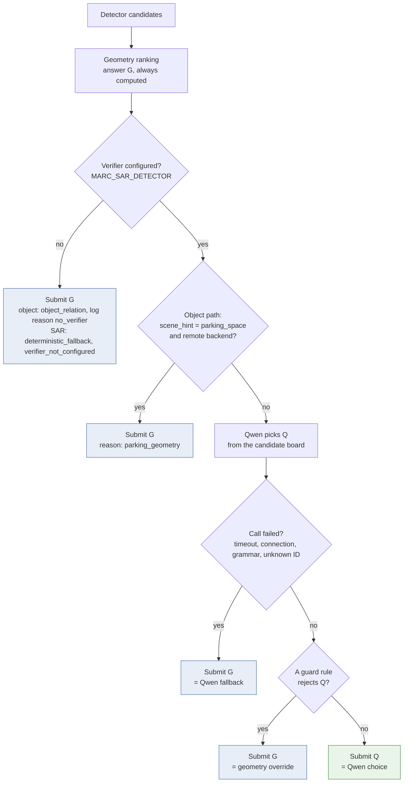

# 0001: Qwen verifies a deterministic geometry ranking

- **Status:** Accepted. Describes the qualifier system at `1450aa9`.
- **Issue:** #85 (part of #92)

## Context

A Stage 1 round needs one target candidate (and an anchor) out of many detector boxes. Two selectors exist:

- the **geometry ranking**: deterministic scoring of target-anchor pairs by class, relation and image geometry;
- the **Qwen verifier**: the fine-tuned Qwen3-VL model, served by vLLM, which reads a candidate board and names one candidate ID.

Qwen is not a fallback for the geometry ranking. The reverse is true: the geometry ranking always runs, and it is both the base answer and the safety net for Qwen.

## Decision

Every round ends in exactly one of three outcomes:

| Outcome | Meaning |
|---|---|
| **Qwen choice** | Qwen answered and no guard rejected it. |
| **Qwen fallback** | The Qwen call failed. The geometry answer is submitted. |
| **Geometry override** | Qwen answered, but a hand-written guard replaced its pick with the geometry answer. |

The guard rules:

- **Object path** (`marc_agent/perception/object_selection.py:1279-1313`): support geometry, contained occlusion, low confidence, weak override.
- **Person (SAR) path** (`marc_agent/perception/sar_selection.py:1007, 1049, 1074, 1128`): `pose_geometry_override`, `support_geometry_override`, `place_geometry_override`, `landmark_geometry_override`.

The SAR path also skips Qwen when no verifier is configured and the shortlist holds at most one person (`sar_selection.py:926`).

## Consequences

- **The pipeline always submits an answer when Qwen is down.** A dead vLLM server degrades the system to deterministic ranking without stopping the round.
- **That degradation was invisible in the object path.** On a failed call, `object_selection.py:1345` returns the geometry answer unchanged, so the round is recorded as `object_relation`, the same label as a run without Qwen. The SAR path already records `deterministic_fallback` with `verifier_failed:<Error>`. #85 makes the object path record `deterministic_fallback` too, with the reason and the step that failed, so that the selector arms in #89 and #90 do not undercount fallbacks. The first live run with this logging found 4 fallbacks in 33 rounds: two vLLM cold-start timeouts in rounds 1–2, and two anchor re-pick replies that gave only a target ID.
- **Geometry overrides were not counted.** They appear only as log text. #85 records them as structured events, with every guard when several fire in one round.
- **Comparing "Qwen on" with "Qwen off" measures more than the selector.** Turning the verifier on also widens the candidate classes, adds a scene-description pass, a class screen and an anchor re-pick (#90). Base Qwen against fine-tuned Qwen isolates the fine-tuning, because both use the same path.
