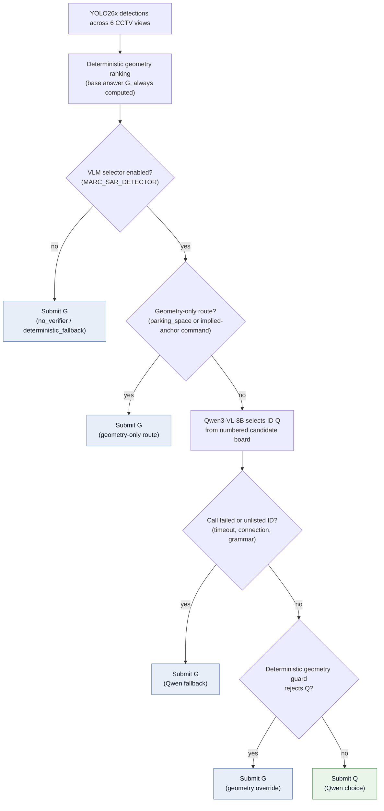

# ADR 0001: Finite-Identifier VLM Selection Over Deterministic Geometry Ranking

- **Status:** Accepted (updated to reflect the final submitted Stage 1 system; see also [ADR 0002](0002-final-stage1-system-cleanup.md)).
- *Note: References to internal development milestones refer to the team's private challenge tracker.*

## Context

Each Stage 1 round requires selecting one target object (or person in distress) and one reference landmark anchor from detections across six fixed campus CCTV cameras. Two complementary selectors operate in our pipeline:

1. **Deterministic geometry ranking:** scores target–anchor pairs in world metres using class matches, spatial relations, and calibrated camera geometry.
2. **Fine-tuned Qwen3-VL-8B selector:** served locally via vLLM; reads a numbered visual candidate board and returns a single listed candidate identifier.

Crucially, Qwen3-VL is **not** a fallback for geometry—the inverse is true. Deterministic geometry always executes first and acts as both the structured shortlist generator and the runtime safety net.

## Decision

Every Stage 1 round terminates in one of three logged outcomes:

| Outcome | Meaning |
|---|---|
| **Qwen choice** | Qwen3-VL-8B returned a valid listed candidate ID and passed all guards. |
| **Qwen fallback** | The VLM call failed, timed out, or returned an unlisted ID; geometry answer `G` is submitted. |
| **Geometry override** | Qwen returned a listed ID, but a deterministic guard replaced it with `G`. |

### Active Guard Rules (Final System)

- **Object path** (`marc_agent.perception.object_selection._select_object_candidate`):
  - `support_geometry_guard` — checks physical support contact for `on` / `above` relations.
  - `weak_override_guard` — rejects a very low-confidence candidate (`< 0.15`) when a high-confidence geometric match (`≥ 0.50`) of the named class exists.
  - `scene_evidence_guard` — checks cross-camera scene consistency.
- **Person / SAR path** (`marc_agent.perception.sar_selection.select_sar_candidate`):
  - `pose_geometry_override`, `support_geometry_override`, `place_geometry_override` (requiring pose, support, and situation eligibility), and `landmark_geometry_override`.
- **Geometry-only routes:** commands targeting `parking_space` or commands with an implied (unnamed) landmark anchor bypass the VLM call and submit `G` directly.

## Consequences

- **Graceful degradation & always-submit guarantee:** If the local vLLM server stalls, times out, or emits malformed output, the agent falls back seamlessly to deterministic geometry without dropping the round.
- **Full decision observability:** Both object and SAR paths log structured decision outcomes (`qwen_choice`, `deterministic_fallback`, and every firing guard), enabling clean end-to-end selector ablations (Paper Table III) and held-out selector arm comparisons (Paper Table V).
- **Clean attribution of VLM vs. fine-tuning gains:** Comparing base `Qwen3-VL-8B-Instruct` against the LoRA-adapted `Qwen3-VL-8B` through the exact same runtime path isolates the contribution of domain fine-tuning (`85.29 → 87.54`, +2.25 pts) from the broader VLM selection gain over geometry alone (`66.36 → 85.29`).
